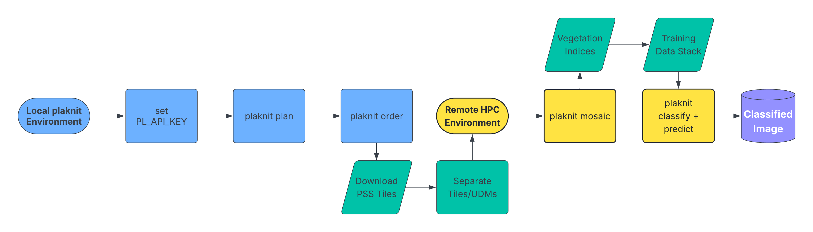

# 🧶 plaknit


[](https://pypi.python.org/pypi/plaknit)
[](https://anaconda.org/conda-forge/plaknit)


**Processing Large-Scale PlanetScope Data**

> Note: plaknit is fully operational as of v0.3.0. Continue to look for updates, and please share feedback or ideas through the GitHub Issues tab.

PlanetScope Scene (PSS) data are reveared for its quality and distinct ability to
balance spatial and temporal resolution in Earth Observation data. While PSS has
proven itself a valuable asset in monitoring small-scale areas, the literature
has pointed out the shortcomings when creating a single image from individual tiles
(Frazier & Hemingway, 2021).

`plaknit` bundles the workflow I use to operationalize large-area mosaics so
you can run the same process locally or in an HPC environment. The goal is to
spend time answering big questions, not making a big mess of your data.

- Free software: MIT License
- Documentation: https://dzfinch.github.io/plaknit

<p align="center">
  
</p>


## Features

- CLI + Python API that scale from local experimentation to HPC batch runs.
- Planning workflow that searches Planet's STAC/Data API and scores scenes, with ordering handled by a separate `plaknit order` workflow.
- GDAL-powered parallel masking of Planet strips with their UDM rasters.
- Tuned Orfeo Toolbox mosaicking pipeline with RAM hints for large jobs.
- Random Forest and Boosted Regression Tree ensemble training + inference utilities for classifying Planet stacks.

## Quick Start

### Train a BRT Ensemble Classifier

```bash
plaknit brt train \
  --image stack.tif \
  --labels training.gpkg \
  --label-column class_id \
  --output ./brt_ensemble/ \
  --n-models 5 \
  --gpu
```

### Apply the Ensemble to New Imagery

```bash
plaknit brt predict \
  --image new_stack.tif \
  --ensemble-dir ./brt_ensemble/ \
  --output-dir ./probability_outputs/ \
  --feature-importance-out predictor_importance.csv
```

See [Usage](https://dzfinch.github.io/plaknit/usage.html) for complete examples and all supported options.

### Compare Spatial Land-Cover Classifications

```bash
plaknit compare spatial \
  --input planet=planet_class.tif \
  --input sentinel=sentinel_class.tif \
  --out-dir ./spatial_compare/ \
  --width 100 --samples 100 --seed 42
```

### Compare Temporal Land-Cover Classifications

```bash
plaknit compare temporal \
  --input june=classification_2023_06.tif --date june=2023-06-15 \
  --input july=classification_2024_07.tif --date july=2024-07-15 \
  --group-by year \
  --out-dir ./temporal_compare/ \
  --width 100 --samples 100 --seed 42
```

Each `--input` has a unique label, which identifies it in tables, plots, and
metadata, even when comparing more than two inputs. Spatial comparisons do not
require dates;
temporal comparisons require a keyed `--date` for every input. The old
`plaknit landcover` command has been replaced; use `plaknit compare spatial` or
`plaknit compare temporal`.

The comparison also produces native-resolution whole-raster and square-level
pylandstats metrics and finest-grid inter-input agreement
summaries. Numeric class codes are assumed to have comparable meanings; this
assumption is recorded, not independently verified. Patch and edge differences can
reflect resolution as well as classification differences. See the [land-cover
comparison guide](https://dzfinch.github.io/plaknit/usage.html#land-cover-comparison)
for flags, output definitions, and limitations.

### Compare Reflectance by Class

```bash
plaknit compare reflectance \
  --input planet=planet_class.tif --raster planet:red=planet_red.tif \
  --input sentinel=sentinel_class.tif --raster sentinel:red=sentinel_red.tif \
  --out-dir ./reflectance_compare/
```

Rasters (bands, NDVI, other indices) are scaled to 0-1 automatically from their
scale/offset metadata, falling back to min/max scaling. The command reports
class-wise median and quartiles and Mann-Whitney U tests between inputs.
